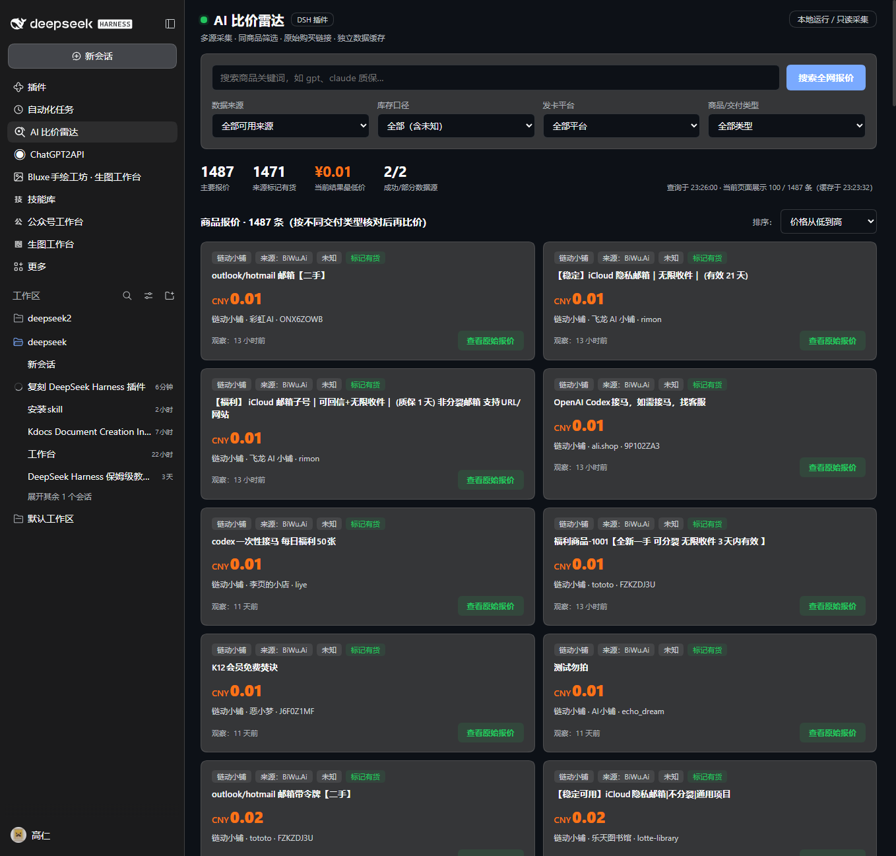

# AI 比价雷达 · DSH 插件

[](https://github.com/deepseek-ai/deepseek-harness)

卡网 AI 订阅**只读比价**面板：把多个公开报价源聚合到 DeepSeek Harness 的一个本地面板里，搜索、四路筛选、直达原始购买链接。**本地运行、只读采集、不参与任何交易。**


## 预览



## 功能

- **全网报价搜索**：按关键词（如 `gpt`、`claude 质保`）过滤聚合报价。
- **四路筛选**：数据来源 / 库存口径（有货·缺货·未知）/ 发卡平台 / 商品交付类型（成品号·代充·卡密·车位·质保）。
- **统计栏**：主要报价数、来源标记有货数、当前结果最低价、数据源成功数。
- **报价卡片**：平台徽标、来源、标题、价格、店铺、观察时间、「查看原始报价」直链。
- **排序与分页**：价格升降序、观察时间序；每次 100 条加载更多。
- **数据来源与口径**：面板内置说明页，写明每个源的抓取方式、授权与局限。

## 安装

### 方式一：DSH 会话里让 AI 装（推荐）

在 DeepSeek Harness 的会话里对 AI 说：

```text
请用 plugin_manager 的 install_bundle 安装这个 DSH 插件包，target 传这个仓库的本地克隆路径：
git clone https://github.com/gaoren7716-lab/dsh-plugin-ai-price-radar.git 然后安装其中的目录。
```

或者一步到位（AI 会自己 clone 并安装）：

```text
帮我安装 GitHub 上的 DSH 插件：https://github.com/gaoren7716-lab/dsh-plugin-ai-price-radar
```

### 方式二：命令行

```sh
git clone https://github.com/gaoren7716-lab/dsh-plugin-ai-price-radar.git
dsh plugin --profile <你的profile名> add ./dsh-plugin-ai-price-radar
```

### 方式三：Harness 界面

**插件** → **添加插件** → 选择克隆下来的目录 → 启用。

装好后左侧栏出现「AI 比价雷达」图标，点开即用。

## 数据来源

| 来源 | 方式 | 授权 |
|---|---|---|
| [BiWu.Ai](https://biwu.ai) | 官方只读快照 feed `/price-radar/latest.json` → 不可变快照，约 5 分钟一版 | 无需鉴权；官方 [API 文档](https://biwu.ai/price-radar-api.md) 明确供 agent / 脚本读取，支持 ETag |
| [AI价网](http://aiprice.club) | 解析公开类目报价表 | 数据遵循 [CC BY 4.0](http://aiprice.club)，署名「AI价网 (http://aiprice.club)」 |
| 链动小铺（wzyp.cn） | 经上述聚合源覆盖 | 不直接抓取 |
| 云猫寄售（catfk.com） | 暂未直连（无公开只读接口） | 其报价经上两源聚合覆盖 |

## 隐私与边界

- 采集请求从**本机宿主进程**发出，不经过任何第三方服务器；结果只保存在内存缓存（5 分钟 TTL）。
- 面板不写入会话日志，不影响模型上下文；不发送任何遥测。
- 所有价格与库存以商家页面为准；本插件只做信息聚合与导航，**不参与任何交易**。

## 架构

```
宿主端 index.js ── webServer 注册 /leida/api/* 路由
  └─ lib/collectors.js ── BiWu 快照 feed + AI价网 HTML 解析（Node 内置 fetch，无依赖）
浏览器端 client.js ── 注册根级 main 键控插槽（整页面板）+ sidebar.panellist（侧栏入口）
```

纯 Node 内置模块，无构建步骤、无运行时依赖。

## 环境要求

- DeepSeek Harness 0.2.x（在 0.2.2-rc.3 实测通过）
- 能访问 `biwu.ai` 与 `aiprice.club`

## License

MIT
